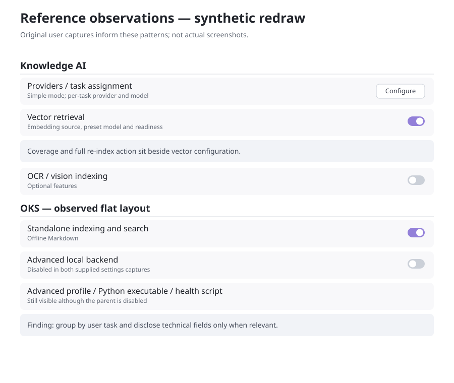
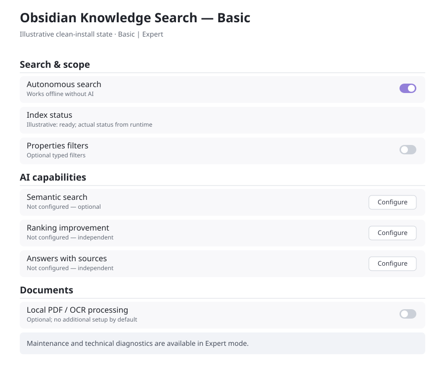
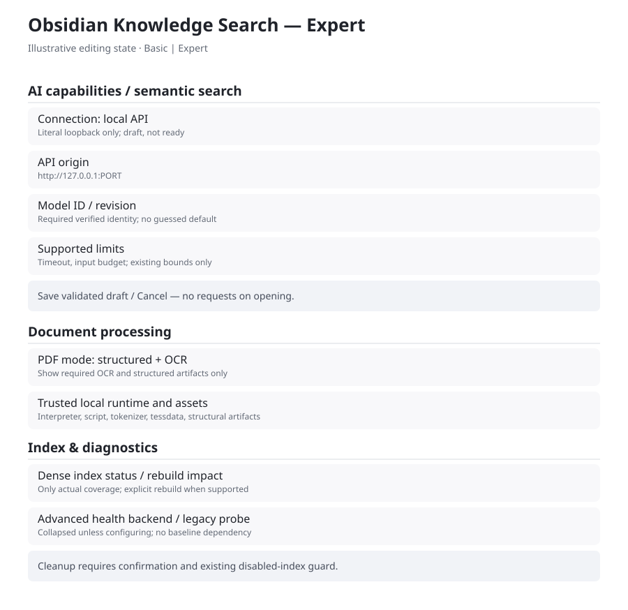

# OKS settings — UX design brief and reference pack

Status: design proposal approved for scheduling, not a pixel-perfect implementation contract. See [execution contract](../../prompts/OKS-06UX.md) for delivery gates. These wireframes are original synthetic reconstructions of the observed patterns, not screenshots of the installed application. All labels/data are illustrative; no real vault, network, credentials or workstation details are included.

## Observed references (maintainer screenshots, 2026-11-24)

The source screenshots show Obsidian settings for Knowledge AI and OKS. The separate workstation dashboard is irrelevant to UX and must not be published. Source screenshots contain private workspace/window metadata, and third-party UI assets have not been cleared for redistribution. Keep originals in the maintainer's private conversation/archive; do not commit raw captures. The sanitized observation drawings below preserve actionable findings and are the repository-safe replacement. Produce real sanitized OKS screenshots using a synthetic vault during implementation.

Knowledge AI: providers list and Add action; task model assignment with Simple mode switch; explicit per-task provider/model; vector retrieval toggle, embedding source/model, model status, vector coverage, full re-index action; image indexing OCR and vision toggles. Disabled/grey controls illustrate partial dependencies, not proof of full conditional behavior. The plaintext API-key warning is a negative reference, not a design to copy. Do not infer features beyond supplied captures or copy vendor implementation.

OKS observed: flat settings rows for Standalone enable/pause, typed Properties opt-in, Top K, advanced backend toggle, profile, Python path and health script path. In both supplied OKS settings captures, technical paths remain displayed while advanced backend is disabled. Property filter toggle differs between captures. Current implementation at planning additionally renders ingestion paths, PDF mode, advanced retrieval operations, separate AI-role preferences, cleanup and legacy probe; re-inventory at implementation because 05P may change these controls.

## Target information architecture

Basic is the default for new installations. Expert is a presentation preference only; switching must neither disable nor enable capabilities or alter configuration. Keep current readiness visible even if details are hidden. Use native Obsidian theme, familiar controls and compact sections, not a bespoke dashboard. Prefer user language over implementation jargon (e.g. Results per search, not Top K). English canonical labels; use existing localization support if available.

| Section | Basic | Expert / contextual detail |
|---|---|---|
| Overview | Basic search status, optional capability summaries, explicit actions needed | Safe diagnostics link; no raw paths or content by default |
| Search & scope | Search on/off, Properties filters when applicable, results count if useful, indexing status | Existing supported scope and tuning controls; no invented settings |
| AI capabilities | Semantic search, ranking improvement, evidence-based answers as independent cards, truthful unavailable states | Per-role verified connection, model identity, revision and supported limits |
| Documents | Optional local document processing with supported PDF/OCR modes | Trusted interpreter/script/tokenizer paths and OCR/structured assets as applicable |
| Index & maintenance | State, progress/coverage if real, safe pause/resume/cancel when relevant | Existing rebuild and guarded cleanup; explicit impact and confirmation |
| Advanced diagnostics | Hidden by default, actionable summary if needed | Local health backend, legacy synthetic probe, sanitized diagnostics |

## Dependency and visibility matrix

| Parent / state | Show / enable | Hide / restrict | Persistence and runtime |
|---|---|---|---|
| Basic/Expert | Basic tasks or additional technical groups | Irrelevant fields even in Expert | Presentation only; no runtime side effects |
| Standalone enabled | Pause/resume and search controls if supported | Cleanup while active (disabled with reason or hidden in maintenance) | Existing lifecycle; no implicit change from mode switch |
| Standalone disabled | Status and enable, eligible maintenance | Active-only actions | Existing stop/clear semantics, not automatic deletion |
| AI role disabled | Role card, enable/configure affordance | Endpoint/model/limits by default | Existing explicit disable semantics; do not invent retained secrets |
| AI role configure | Required fields in draft, inline validation, save/cancel | Non-applicable provider fields | Commit complete validated configuration atomically; no calls on opening |
| Local transport | Literal loopback origin, required identity and supported auth path | Cloud-specific permission controls | Existing trust bounds; local does not imply safe or ready |
| Cloud transport | HTTPS origin and explicit processing boundary/authorization status; only supported credential-reference control | Unsupported activation; no plaintext secret field | No auto-egress; preserve current runtime deny rules |
| Embedding selected | Model/space identity, dense index readiness and rebuild impact | Semantic/hybrid success claim unless actual leg ready | One active dense space; staged migration, explicit consent |
| Rerank or generation selected | Its own connection/model and evidence-based status | Mandatory dense/index requirement | Independent roles; do not reindex on role-only changes |
| Advanced ingestion disabled | Status and setup action | Runtime paths, extraction controls | No new runtime start |
| Ingestion configured / native text | Required trusted interpreter, script, tokenizer and mode | OCR and structured-only paths | Draft then validated activation |
| OCR or structured+OCR | OCR language assets (RU/EN as supported) | Unrelated options | Existing local-only processing |
| Structured or structured+OCR | Pinned structured artifacts path | Unrelated options | Existing local-only processing |
| Health backend disabled | Expert summary and configure action | Profile/path fields until editing | No Python required for baseline |
| Legacy probe disabled | Expert diagnostic disclosure only | Fixture paths until configured | Synthetic fixtures only; never used for baseline |
| Rebuild / cleanup | Exact operation scope, progress and cancellation if supported | Unsafe concurrent/destructive actions | Existing guard; confirm deletion of derived files only |

## State and workflows

1. First use: open Basic; autonomous search ready/indexing; optional features disabled/unavailable; no setup required. Search immediately.
2. Configure AI: select one task, choose supported transport/adapter, enter required connection and model details or verified preset, validate/save a complete draft. Repeat independently for other roles. Explicit user-triggered supported verification only; connection test is not permission to disclose notes. For cloud, display policy/approval boundary; unavailable provider cannot be activated by a UI shortcut.
3. Change model: show identity and compatibility, explain reindex requirement before any action. Preserve basic search and current valid dense generation per existing migration semantics. No silent fallback.
4. Advanced docs: open section, select supported processing mode, reveal only applicable paths/required assets; validate then enable. No automatic downloads.
5. Troubleshooting: inspect status and actionable sanitized reason, open Expert details, cancel/retry as already supported; cleanup confirmation clearly distinguishes derived data from notes.

Status vocabulary: Disabled, Not configured, Configured / not verified, Permission required, Initializing, Ready, Busy, Unavailable, Failed, Cancelled. Map only states that can be proven from existing runtime or local UI draft; never invent successful readiness or use color alone. No numerical coverage unless trustworthy denominator and current generation are known.

## Design notes and open checks

- Prefer existing native SDK and verify supported minAppVersion; planning manifest is 1.15.1. Evaluate conditional declarative settings and secret references against actual installed SDK/host support; no unconditional API migration or new auth design.
- A reusable provider catalog may reduce duplication, but is not a required persisted schema redesign. First prove mapping to per-role preferences and compatibility/security. If sharing or secret management requires new runtime behavior, split into a separate reviewed contract.
- Existing full redraw after save and per-field persistence are risks for focus and mutually dependent validation. Address both without adding an independent runtime authority.
- Use synthetic screenshots for acceptance. Third-party visual inspiration is limited to general interaction patterns; no copied source or assets.
